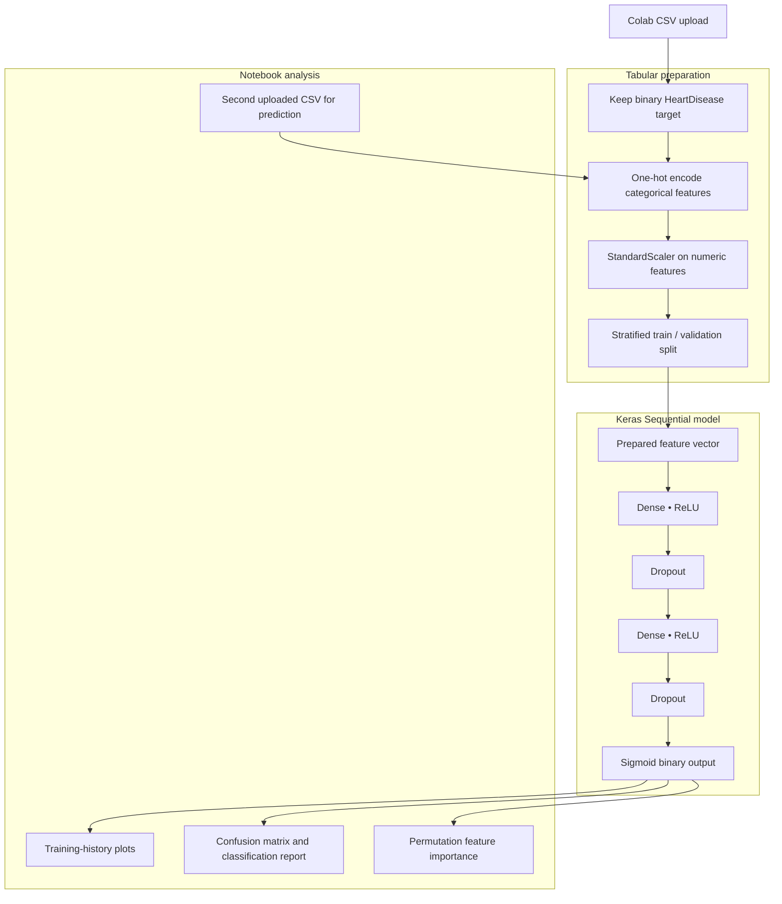

# HeartDiseaseNN

**Tabular heart-disease classification with a neural network**

## Overview

HeartDiseaseNN is a TensorFlow/Keras educational workflow for exploring a tabular heart-health dataset. It prepares categorical and numerical variables, trains a dense neural network, and inspects predictions and feature importance using familiar machine-learning tools.

### Why it matters

A structured health-data example provides an accessible way to study end-to-end deep-learning practice, including preprocessing, training, and model interpretation. The repository demonstrates those engineering steps without presenting model output as medical guidance.

## Key capabilities

- Loads a user-provided CSV in a Google Colab-oriented workflow.
- Encodes categorical variables and standardizes numerical columns.
- Separates training and validation records.
- Builds a dense Keras classifier with dropout.
- Visualizes training curves and classification diagnostics.
- Explores feature importance using post-training analysis.

## System architecture



### How the workflow operates

The script imports a dataset, checks the target column, creates model features, and applies categorical encoding and scaling. The neural network is trained on the prepared records, followed by predictions and visual diagnostic plots.

The checked-in file contains Colab notebook-style commands, so it should be run in a compatible notebook environment rather than assumed to work as an ordinary local Python script.

## Technology stack

| Technology | Purpose |
| --- | --- |
| **Python / pandas / NumPy** | Data handling and preprocessing |
| **scikit-learn** | Data splitting, scaling, diagnostics |
| **TensorFlow / Keras** | Neural network construction and training |
| **Matplotlib / seaborn** | Training and prediction visualization |
| **Google Colab** | Notebook-oriented execution environment |

## Repository structure

```text
heartdisease_nn_.py    Colab-exported neural-network workflow
sample_heart_data.csv  Sample tabular dataset
README.md              Project documentation (draft branch)
```

## Getting started

```bash
# Open heartdisease_nn_.py as notebook content in Colab.
# Upload a compatible CSV that includes HeartDisease.
# Execute the notebook cells in order.
```

## Notes and prerequisites

This project is for learning and experimentation only; its outputs are not medical predictions for clinical use. Colab-specific `!pip` and upload commands are not valid in a plain Python interpreter.
